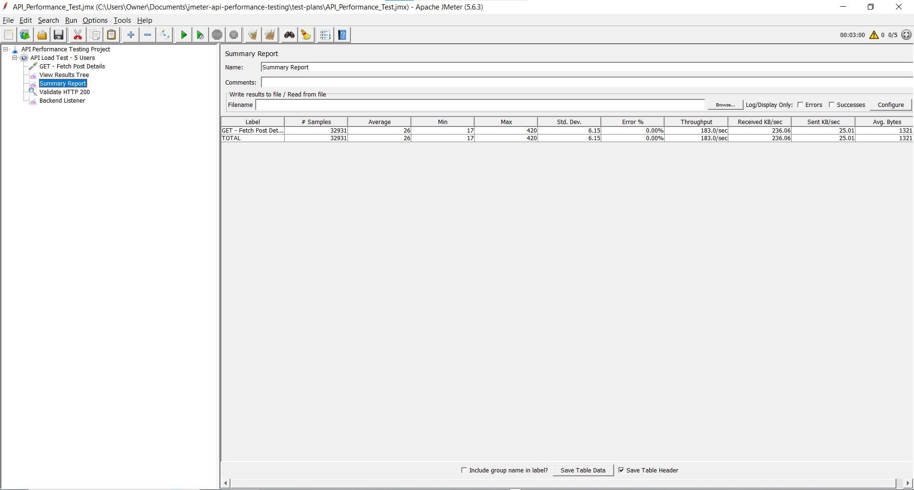
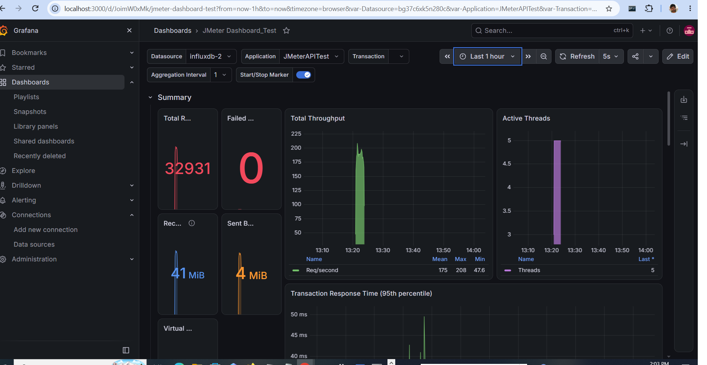
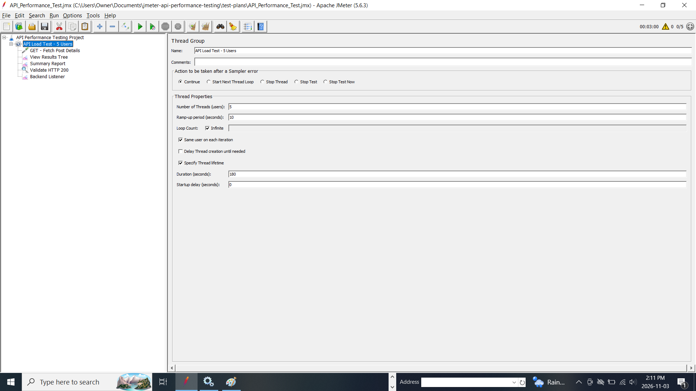

# REST API Performance Testing using Apache JMeter

## Project Overview
A hands-on performance engineering project to evaluate REST API response times, throughput, and reliability using Apache JMeter, InfluxDB, and Grafana.

## Technology Stack
- Apache JMeter 5.6.3
- InfluxDB 1.13.2
- Grafana
- REST API (JSONPlaceholder)
- GitHub

## Test Scenario
- API operation: GET - Fetch Post Details
- Virtual users: 5
- Test duration: 3 minutes
- HTTP response validation: 200 OK
- Metrics collected: response time, throughput, errors, and active threads

## Performance Test Results
| Metric | Result |
|---|---|
| Total requests | 32,931 |
| Average response time | 26 ms |
| Minimum response time | 17 ms |
| Maximum response time | 420 ms |
| Error rate | 0% |
| Throughput | 183 requests/second |

These results represent one observed test execution and are not a guarantee of production performance.

## Monitoring Architecture
JMeter → Backend Listener → InfluxDB → Grafana

JMeter generates HTTP requests and sends performance metrics through the Backend Listener to InfluxDB. Grafana queries InfluxDB to visualize throughput, response times, errors, and active threads.

## Screenshots

## Key Learnings
- Designed and executed REST API load tests using JMeter
- Configured HTTP response assertions
- Integrated JMeter with InfluxDB using a Backend Listener
- Visualized performance metrics using Grafana
- Investigated integration and configuration issues

## Project Scope
This is a portfolio demonstration using a public test API, not a production capacity assessment. Further work could include multiple load levels, baseline comparisons, and automated test execution.
